# PixRevive — Codebase Navigation Map (`map`)

This map provides a quick-reference index to navigate the codebase, understand the 14-stage restoration pipeline, and locate key symbols instantly.

---

## 1. Pipeline Execution Flow (Stages 00 – 10b)

All stages are orchestrated in [`backend/ai/pipeline/restoration_pipeline.py`](file:///d:/Desktop/kapstone/kapstone/PixRevive/backend/ai/pipeline/restoration_pipeline.py):

```mermaid
flowchart TD
    S0["Stage 0: Impulse / Speck Suppression (ImpulseDenoiser + SpeckSuppressor)"] --> S1["Stage 1: Degradation Analysis (QualityAnalyzer)"]
    S1 --> S1b["Stage 1b: Early Face & Landmark Detection (RetinaFace)"]
    S1b --> S2["Stage 2: Multi-Scale Fracture Masking (U-Net + EnhancedDetector + MaskRefiner)"]
    S2 --> S3["Stage 3: LaMa Deep Inpainting + Seam Smoothing + Circuit Breaker"]
    S3 --> S2b["Stage 2b: High-Variance Damage Cluster Smoothing"]
    S2b --> S3b["Stage 3b: Post-Inpaint Face Re-Detection (All Faces & Landmarks)"]
    S3b --> S5["Stage 5: Spatially-Gated 3-Zone Denoising (Face / Mid / BG NLM)"]
    S5 --> S6["Stage 6: DDColor Colorization + Chrominance Infill Diffusion"]
    S6 --> S6c["Stage 6c: Color Artifact Reduction (Banding, Saturation, Bleed)"]
    S6c --> S7["Stage 7: GFPGAN Damage-Aware Face Restoration (or deferred if <90px)"]
    S7 --> S8["Stage 8: Pre-SR Bilateral Anti-Aliasing (L* & Chroma)"]
    S8 --> S9["Stage 9: Real-ESRGAN x4plus Super-Resolution + Inpaint Seam Harmonizer"]
    S9 --> S9c["Stage 9c: Post-SR Deferred Face Restoration (for small faces)"]
    S9c --> S10["Stage 10: Contrast-Adaptive LAB Sharpening"]
    S10 --> S10b["Stage 10b: Projector Exhibition Grade (CLAHE + Shadow S-Curve)"]
```



| Stage | Method in `restoration_pipeline.py` | Responsible Module | Description |
|---|---|---|---|
| **0** | `_stage_0_despeckle` | `ai.preprocessing.impulse_denoiser` + `speck_suppressor` | ROAD impulse filter for dust/pinholes + spatial autocorrelation speck field suppressor |
| **1** | `_stage_1_analyze` | `ai.analysis.quality_analyzer` | Computes blur, grain, damage %, and color mode (`grayscale`, `sepia`, `color`) |
| **1b**| `_stage_4_face_detect` (early) | `ai.analysis.face_detector` | Multi-face RetinaFace & Haar detection; extracts bboxes, 5 landmarks, ocular/oral protection zones |
| **2** | `_stage_2_fracture_masking` | `ai.damage.enhanced_detector` + `mask_refiner` | U-Net semantic cracks, classical white flakes, wide cracks, directional scratches, 3D paper tears, and tearmarks |
| **3** | `_stage_3_lama_inpaint` | `ai.restoration.inpainting_engine` / LaMa | Fourier-domain deep infill + boundary seam Gaussian feathering + edge-energy face circuit breaker |
| **2b**| `_stage_2b_damage_cluster_smooth` | `restoration_pipeline.py` | Local variance smoothing (variance > 35.0, h=10.0) on inpaint perimeters outside face safe-zones |
| **3b**| `_stage_3b_refresh_faces` | `ai.analysis.face_detector` | Re-scans repaired canvas to recover faces/landmarks previously obscured by cracks |
| **5** | `_stage_5_spatially_gated_denoise` | `ai.postprocessing.noise_router` + `restoration_pipeline` | Face adaptive NLM (preserving anatomy), Mid-zone subject NLM, and Background NLM (scaled to noise floor $\sigma$) |
| **6** | `_stage_6_colorization` | `ai.colorization.ddcolor_colorizer` | ICCV 2023 DDColor global transform + smooth ambient chrominance diffusion across inpaint zones |
| **6c**| Inline in `restore()` | `ai.colorization.color_refiner` | Banding reduction, saturation balancing, and luminance-guided edge color-bleed repair |
| **7** | `_stage_7_face_restoration` | `ai.restoration.face_restorer` | GFPGAN v1.4 damage-aware blending across all detected faces; defers small faces (<90px) to post-SR |
| **8** | `_stage_8_presr_antialiasing` | `restoration_pipeline.py` | Bilateral filter on L* (and chroma if noisy) to suppress screening artifacts before 4x upscaling |
| **9** | `_stage_9_super_resolution` | `ai.restoration.super_resolution` | Real-ESRGAN x4plus (tiled, 2K normalized, max 4096px) + `Harmonizer` inpaint seam blending |
| **9c**| Inline in `restore()` | `ai.restoration.face_restorer` | Deferred GFPGAN pass on 4x upscaled canvas for small/low-res faces |
| **10** | `_stage_10_post_sr_sharpen` | `ai.restoration.super_resolution` / `enhancer` | Post-SR luminance-only LAB unsharp masking |
| **10b**| `_stage_10b_projector_grade` | `restoration_pipeline.py` | Exhibition CLAHE (clip=1.6) + smooth shadow-lifting tone curve ($y = 0.03 + 0.97x^{0.88} + 0.04\sin(\pi x)$) |

---

## 2. Directory Map & Module Index

```
PixRevive/
├── backend/
│   ├── main.py                               # FastAPI application entry point & CORS
│   ├── routers/
│   │   ├── restoration.py                    # Endpoints: /api/restore, /api/process, /api/process-stream, /api/health
│   │   ├── comparison.py                     # Side-by-side / slider comparison data
│   │   └── history.py                        # Processed image history & cache
│   │
│   ├── ai/
│   │   ├── pipeline/
│   │   │   ├── restoration_pipeline.py       # Full 14-stage restoration orchestrator (restore & process methods)
│   │   │   ├── pipeline_context.py           # State container: working_image, damage_masks, metadata, timers
│   │   │   ├── pipeline_router.py            # Routing decisions based on image analysis
│   │   │   └── debug_logger.py               # Debug stage snapshots saved to debug_output/
│   │   │
│   │   ├── preprocessing/
│   │   │   ├── impulse_denoiser.py           # ROAD-test discrete salt-and-pepper / dust outlier filter
│   │   │   ├── speck_suppressor.py           # Dense low-amplitude speck field suppressor (autocorr + edge co-location)
│   │   │   ├── halftone_suppressor.py        # Notch / frequency-domain screening suppressor for scanned prints
│   │   │   └── image_normalizer.py           # Aspect ratio, channel, and bit-depth normalization
│   │   │
│   │   ├── damage/
│   │   │   ├── enhanced_detector.py          # Scratches, dark spots, white flakes, wide cracks, 3D paper tears
│   │   │   ├── mask_refiner.py               # Mask fusion, ocular/oral protection, border artifact stripping
│   │   │   ├── defect_segmenter.py           # U-Net learned crack segmentation network
│   │   │   └── tearmark_detector.py          # 3-pass saturation-aware sepia/color emulsion flaking detector
│   │   │
│   │   ├── analysis/
│   │   │   ├── quality_analyzer.py           # Sharpness, noise score, color_type (sepia/grayscale/color)
│   │   │   ├── face_detector.py              # RetinaFace + Haar cascade multi-face & 5-landmark detector
│   │   │   └── color_analyzer.py             # Chrominance distribution & saturation analysis
│   │   │
│   │   ├── restoration/
│   │   │   ├── face_restorer.py              # GFPGAN v1.4, multi-face damage-aware composite, fidelity=0.85
│   │   │   ├── super_resolution.py           # RealESRGAN x4, 2K normalizer, tiled inference, LAB post-sharpening
│   │   │   ├── inpainting_engine.py          # LaMa orchestrator + OpenCV Telea fallback
│   │   │   └── lama_inpaint.py               # Deep LaMa (TorchScript big-lama.pt)
│   │   │
│   │   ├── colorization/
│   │   │   ├── ddcolor_colorizer.py          # DDColor ICCV 2023 global wrapper (512px input) + chroma blending
│   │   │   ├── color_refiner.py              # BandingReducer, SaturationBalancer, EdgeAwareColorBleedFixer
│   │   │   └── ddcolor/                      # Vendored upstream DDColor inference source code
│   │   │
│   │   ├── postprocessing/
│   │   │   ├── denoiser.py                   # AdaptiveDenoiser, WaveletDenoiser, SmartDenoiser, ArtifactDetector
│   │   │   ├── enhancer.py                   # Enhancer (adaptive USM, gentle CLAHE, color cast correction, micro-texture)
│   │   │   ├── noise_router.py               # Noise type classifier & multi-filter dispatch
│   │   │   └── film_grain.py                 # Subtle analog film grain synthesis
│   │   │
│   │   ├── validation/
│   │   │   ├── identity_validator.py         # SSIM & facial landmark distance verification
│   │   │   └── damage_validator.py           # Residual defect checks & inpaint quality score
│   │   │
│   │   └── weights/                          # ALL model checkpoints (.pth, .pt) live here
│   │       ├── ddcolor/                      # ddcolor_modelscope.pth (~870 MB)
│   │       ├── facelib/                      # RetinaFace detection checkpoints
│   │       ├── big-lama.pt                   # LaMa inpainting model
│   │       ├── GFPGANv1.4.pth                # GFPGAN face restoration
│   │       └── RealESRGAN_x4plus.pth         # Real-ESRGAN 4x super-resolution
│   │
│   └── requirements.txt                      # Backend dependencies
│
├── frontend/                                 # Vite + React UI
│   └── src/
│       ├── App.jsx                           # Main layout & upload dropzone
│       └── components/
│           ├── ComparisonSlider.jsx          # Interactive before/after split slider
│           ├── ProgressBar.jsx               # Monotonic stage progress visualizer
│           └── SettingsPanel.jsx             # Toggle flags (repair, denoise, colorize, face, sr)
│
├── tests/                                    # Automated pytest test suite
│   ├── restoration_dataset/
│   │   └── damaged/                          # Standard test fixtures: case1 to case6
│   │       ├── case1_noisy_lena.jpg          # Gaussian noise on flat grayscale
│   │       ├── case2_dead_tree_landscape.jpg # Landscape macro-edges
│   │       ├── case3_sepia_flaked_portrait.jpg# Emulsion flaking on sepia portrait
│   │       ├── case4_diagonal_tear_portrait.jpg# Diagonal paper fracture
│   │       ├── case5_spiderweb_creases_portrait.jpg# Spiderweb facial cracks + open smile
│   │       └── case6_severe_3d_torn_photo.png# Severe 3D paper tear & curl
│   ├── test_restoration_regressions.py       # Pipeline regressions, damage guards, low-res noise
│   ├── test_identity_preservation.py         # Face identity & SSIM stability
│   └── test_facial_landmarks.py              # Landmark detection accuracy
│
├── .agents/                                  # Workspace agent rules & skills
│   └── rules/
│       ├── python_runtime.md                 # Enforced Python 3.12 path & venv prohibition
│       └── project_shorthands.md             # 'reload' and 'map' shortcuts
│
├── CLAUDE.md                                 # Canonical agent rules
├── AGENTS.md                                 # Codex/agent rules
└── GEMINI.md                                 # Gemini agent rules
```

---

## 3. Architecture Status: Semantic Segmentation & Multi-Face Colorization

* **Semantic Segmentation**: **Currently Absent.** PixRevive does not possess a semantic material segmentation stage (e.g. clothing, skin, hair, background materials). Any material-aware colorization gating must be introduced as a new module.
* **Multi-Face Handling**: `FaceDetector.detect()` identifies **all faces** with bounding boxes and 5 landmarks, which are leveraged in Stage 5 (3-zone NLM) and Stage 7 (GFPGAN). Stage 6 (DDColor) does not currently consume face landmarks, applying a global transformation.

---

## 4. Quick Reference: Project Commands

| Command | Action / Meaning |
|---|---|
| **`reload`** | Reload/restart backend: `& "C:\Program Files\Python312\python.exe" -m uvicorn main:app --host 127.0.0.1 --port 8000` |
| **`map`** | View this navigation map ([CODEBASE_MAP.md](file:///d:/Desktop/kapstone/kapstone/PixRevive/CODEBASE_MAP.md)) |
| **`test`** | Run pytest: `$env:PYTHONPATH='backend'; & "C:\Users\sangh\AppData\Roaming\Python\Python312\Scripts\pytest.exe" tests/` |
| **`ddcolor-setup`**| Install DDColor: `& "C:\Program Files\Python312\python.exe" backend/ai/install_ddcolor.py` |
