# PixRevive — Codebase Navigation Map (`map`)

This map provides a quick-reference index to navigate the codebase, understand the 14-stage restoration pipeline, and locate key symbols instantly.

---

## 1. Pipeline Execution Flow (Stages 00 – 12)

All stages are orchestrated in [`backend/ai/pipeline/restoration_pipeline.py`](file:///d:/Desktop/kapstone/kapstone/PixRevive/backend/ai/pipeline/restoration_pipeline.py):

```mermaid
flowchart TD
    S0["Stage 0: Impulse / Speck Suppression (ImpulseDenoiser + SpeckSuppressor)"] --> S1["Stage 1: Degradation Analysis (QualityAnalyzer)"]
    S1 --> S1b["Stage 1b: Early Face & Landmark Detection (RetinaFace)"]
    S1b --> S2["Stage 2: Multi-Scale Fracture Masking (U-Net + EnhancedDetector + MaskRefiner)"]
    S2 --> S3["Stage 3: LaMa Deep Inpainting + Seam Smoothing + Circuit Breaker"]
    S3 --> S2b["Stage 2b: High-Variance Damage Cluster Smoothing"]
    S2b --> S3b["Stage 3b: Post-Inpaint Face Re-Detection (All Faces & Landmarks)"]
    S3b --> S5["Stage 5: Spatially-Gated 3-Zone Denoising (Face / Mid / BG NLM)"]
    S5 --> S6["Stage 6: DDColor Colorization + Chrominance Infill Diffusion"]
    S6 --> S6c["Stage 6c: Color Artifact Reduction (Banding, Saturation, Bleed)"]
    S6c --> S7["Stage 7: GFPGAN Damage-Aware Face Restoration (or deferred if <90px)"]
    S7 --> S8["Stage 8: Pre-SR Bilateral Anti-Aliasing (L* & Chroma)"]
    S8 --> S9["Stage 9: Real-ESRGAN x4plus Super-Resolution + Inpaint Seam Harmonizer"]
    S9 --> S9c["Stage 9c: Post-SR Deferred Face Restoration (for small faces)"]
    S9c --> S10["Stage 10: Contrast-Adaptive LAB Sharpening"]
    S10 --> S10b["Stage 10b: Projector Exhibition Grade (CLAHE + Shadow S-Curve)"]
    S10b --> S12["Stage 12: Re-imagine Unrecoverable Damage (SD inpainting + IP-Adapter + SFace gate, beta)"]
```



| Stage | Method (defined in `pipeline/stages/*` mixins) | Responsible Module | Description |
|---|---|---|---|
| **0** | `_stage_0_despeckle` | `ai.preprocessing.impulse_denoiser` + `speck_suppressor` | ROAD impulse filter for dust/pinholes + spatial autocorrelation speck field suppressor |
| **1** | `_stage_1_analyze` | `ai.analysis.quality_analyzer` | Computes blur, grain, damage %, and color mode (`grayscale`, `sepia`, `color`) |
| **1b**| `_stage_4_face_detect` (early) | `ai.analysis.face_detector` | Multi-face RetinaFace & Haar detection; extracts bboxes, 5 landmarks, ocular/oral protection zones |
| **2** | `_stage_2_fracture_masking` | `ai.damage.enhanced_detector` + `mask_refiner` | U-Net semantic cracks, classical white flakes, wide cracks, directional scratches, 3D paper tears, and tearmarks |
| **3** | `_stage_3_lama_inpaint` | `ai.restoration.inpainting_engine` / LaMa | Fourier-domain deep infill + boundary seam Gaussian feathering + edge-energy face circuit breaker |
| **2b**| `_stage_2b_damage_cluster_smooth` | `restoration_pipeline.py` | Local variance smoothing (variance > 35.0, h=10.0) on inpaint perimeters outside face safe-zones |
| **3b**| `_stage_3b_refresh_faces` | `ai.analysis.face_detector` | Re-scans repaired canvas to recover faces/landmarks previously obscured by cracks |
| **5** | `_stage_5_spatially_gated_denoise` | `ai.postprocessing.noise_router` + `restoration_pipeline` | Face adaptive NLM (preserving anatomy), Mid-zone subject NLM, and Background NLM (scaled to noise floor $\sigma$) |
| **6** | `_stage_6_colorization` | `ai.colorization.ddcolor_colorizer` | ICCV 2023 DDColor global transform + smooth ambient chrominance diffusion across inpaint zones |
| **6c**| Inline in `restore()` | `ai.colorization.color_refiner` | Banding reduction, saturation balancing, and luminance-guided edge color-bleed repair |
| **7** | `_stage_7_face_restoration` | `ai.restoration.face_restorer` | GFPGAN v1.4 damage-aware blending across all detected faces; defers small faces (<90px) to post-SR |
| **8** | `_stage_8_presr_antialiasing` | `restoration_pipeline.py` | Bilateral filter on L* (and chroma if noisy) to suppress screening artifacts before 4x upscaling |
| **9** | `_stage_9_super_resolution` | `ai.restoration.super_resolution` | Real-ESRGAN x4plus (tiled, 2K normalized, max 4096px) + `Harmonizer` inpaint seam blending |
| **9c**| Inline in `restore()` | `ai.restoration.face_restorer` | Deferred GFPGAN pass on 4x upscaled canvas for small/low-res faces |
| **10** | `_stage_10_post_sr_sharpen` | `ai.restoration.super_resolution` / `enhancer` | Post-SR luminance-only LAB unsharp masking |
| **10b**| `_stage_10b_projector_grade` | `restoration_pipeline.py` | Exhibition CLAHE (clip=1.6) + smooth shadow-lifting tone curve ($y = 0.03 + 0.97x^{0.88} + 0.04\sin(\pi x)$) |
| **12** | `_stage_12_reimagine` | `ai.restoration.reimaginer` + `ai.restoration.resource_profiler` | Phase-H1 beta: fires only when ≥35% frame or ≥55% worst-face Destroy coverage; SD1.5/SDXL inpainting re-imagines ONLY the lost regions (evidence composited back bytewise), IP-Adapter conditions on the surviving face, SFace identity gate (≥0.42 pass / 0.36–0.42 flag / <0.36 rollback, ≤2 re-rolls) reverts to the LaMa canvas on failure. Resource-tiered (MINIMAL = fp32 + sequential CPU offload, measured 0.76 GB VRAM); `enable_reimagine=false` by default |

---

## 2. Directory Map & Module Index

```
PixRevive/
├── backend/
│   ├── main.py                               # FastAPI app: CORS allowlist, static training_data mount, /health (delegates to pipeline.health_status())
│   ├── routers/
│   │   ├── image_router.py                   # /api/upload, /api/process, /api/process-stream (SSE), /api/process/{id}/result|status
│   │   └── admin_router.py                   # /api/admin/* weights & training-data CRUD; /training/start|status are honest 501 stubs
│   │
│   ├── ai/
│   │   ├── pipeline/
│   │   │   ├── restoration_pipeline.py       # Thin orchestrator: restore() prelude + registry-driven dispatch (restore & process methods)
│   │   │   │                                 #   Stage 2 also wires foxing/mold dark spots (T-1) into the damage mask
│   │   │   ├── stage_registry.py             # Ordered StageSpec list — single source of truth for stage ids/methods/percentages/gates (A-2)
│   │   │   ├── stages/                       # Stage bodies as mixins on RestorationPipeline:
│   │   │   │   ├── preprocess_stages.py      #   0 despeckle, 1 analyze, 4 face detect
│   │   │   │   ├── damage_stages.py          #   2 masking, 3 LaMa inpaint (+ seam/protect/breaker sub-steps), 2b cluster smooth, 3b face refresh
│   │   │   │   ├── color_stages.py           #   5 denoise, 6 colorization, 7 face restoration
│   │   │   │   └── finish_stages.py          #   8 pre-SR AA, 9 SR, 10 sharpen, 10b projector grade, 12 re-imagine
│   │   │   ├── pipeline_context.py           # State container: working_image, damage_masks, metadata, timers
│   │   │   ├── pipeline_router.py            # Routing decisions based on image analysis (6 named routes + SAFE_FALLBACK)
│   │   │   └── debug_logger.py               # Debug stage snapshots saved to debug_output/
│   │   │
│   │   ├── preprocessing/
│   │   │   ├── impulse_denoiser.py           # ROAD-test discrete salt-and-pepper / dust outlier filter
│   │   │   ├── speck_suppressor.py           # Dense low-amplitude speck field suppressor (autocorr + edge co-location)
│   │   │   ├── halftone_suppressor.py        # Notch / frequency-domain screening suppressor for scanned prints
│   │   │   └── image_normalizer.py           # Aspect ratio, channel, and bit-depth normalization
│   │   │
│   │   ├── damage/
│   │   │   ├── enhanced_detector.py          # Scratches, dark spots, white flakes, wide cracks, 3D paper tears
│   │   │   ├── mask_refiner.py               # Mask fusion, ocular/oral protection, border artifact stripping
│   │   │   ├── defect_segmenter.py           # U-Net learned crack segmentation network
│   │   │   └── tearmark_detector.py          # 3-pass saturation-aware sepia/color emulsion flaking detector
│   │   │
│   │   ├── analysis/
│   │   │   ├── quality_analyzer.py           # Sharpness, noise score, color_type (sepia/grayscale/color), content_region (margin-robust sigma)
│   │   │   ├── face_detector.py              # RetinaFace + Haar cascade multi-face & 5-landmark detector
│   │   │   ├── content_region.py             # Content-vs-margin mask + robust sigma (case8 margin fix)
│   │   │   └── quality_service.py            # Quality analysis service layer
│   │   │
│   │   ├── restoration/
│   │   │   ├── resource_profiler.py          # Phase-H1: 4-level resource tiers (MINIMAL/STANDARD/AMPLE/REFUSED) from measured VRAM/RAM; pins dtype & SD variant; REIMAGINE_FORCE_TIER override
│   │   │   ├── reimaginer.py                 # Phase-H1 beta engine: evidence-preserving SD inpainting of lost regions, IP-Adapter identity conditioning, NaN self-heal, SFace rollback ladder
│   │   │   ├── face_restorer.py              # GFPGAN v1.4, multi-face damage-aware composite, fidelity=0.85
│   │   │   ├── super_resolution.py           # RealESRGAN x4, 2K normalizer, tiled inference, LAB post-sharpening
│   │   │   ├── inpainting_engine.py          # LaMa orchestrator + OpenCV Telea fallback
│   │   │   ├── lama_restorer.py              # Deep LaMa loader (TorchScript big-lama.pt)
│   │   │   ├── rrdbnet.py                    # RRDBNet architecture for Real-ESRGAN weights
│   │   │   └── super_resolution.py           # RealESRGAN x4, 2K normalizer, tiled inference (SuperResolution)
│   │   │
│   │   ├── colorization/
│   │   │   ├── ddcolor_colorizer.py          # DDColor ICCV 2023 global wrapper (512px input) + chroma blending
│   │   │   ├── color_refiner.py              # BandingReducer, SaturationBalancer, EdgeAwareColorBleedFixer
│   │   │   └── ddcolor/                      # Vendored upstream DDColor inference source code
│   │   │
│   │   ├── report/
│   │   │   └── restoration_report.py         # T-2 honesty layer: recovered/reconstructed/flagged per run (plan 5.1)
│   │   │
│   │   ├── postprocessing/
│   │   │   ├── enhancer.py                   # Harmonizer — guided-filter seam blending along inpainting rims (Enhancer class deleted, D17)
│   │   │   └── noise_router.py               # Noise type classifier (30 types) & multi-filter dispatch (denoiser stack pruned, plan 5.4)
│   │   │
│   │   ├── validation/
│   │   │   ├── identity_validator.py         # SSIM & facial landmark distance verification
│   │   │   ├── face_identity_gate.py         # Phase-H1: YuNet detect + SFace cosine identity gate (0.42/0.36 thresholds) for the re-imagine stage
│   │   │   └── forensic_validator.py         # Residual defect checks & inpaint quality score
│   │   │
│   │   ├── (orchestrator moved to experimental/orchestrator — parked engine, plan 5.2)
│   │   │
│   │   ├── download_weights.py               # Canonical checkpoint download manifest (GitHub/HF → backend/ai/weights/)
│   │   └── install_ddcolor.py                # DDColor vendored-source installer
│   │
│   ├── services/
│   │   └── image_service.py                  # Singleton pipeline façade: ImageService.process_image, task store
│   │
│   └── requirements.txt                      # Backend dependencies
│   │   │
│   │   └── weights/                          # ALL model checkpoints (.pth, .pt) live here
│   │       ├── ddcolor/                      # ddcolor_modelscope.pth (~870 MB)
│   │       ├── facelib/                      # RetinaFace detection checkpoints
│   │       ├── big-lama.pt                   # LaMa inpainting model
│   │       ├── GFPGANv1.4.pth                # GFPGAN face restoration
│   │       ├── RealESRGAN_x4plus.pth         # Real-ESRGAN 4x super-resolution
│   │       ├── sd15_inpaint/                 # Phase-H1: SD-1.5 inpainting fp16 (runwayml org dead; official redirect target)
│   │       ├── ip_adapter/                   # Phase-H1: h94 repo layout — models/ip-adapter_sd15.safetensors + models/image_encoder/ (config.json self-heals from reimaginer.py)
│   │       └── sface/                        # Phase-H1: YuNet detector + SFace recognizer ONNX (identity gate)
│   │
│   └── requirements.txt                      # Backend dependencies
│
├── experimental/                             # Parked experiments — not part of the app
│   └── orchestrator/                         # Two-Tier PPCAV engine, archived per plan 5.2 (see its README)
│
├── frontend/                                 # Vite + React UI
│   └── src/
│       ├── App.jsx                           # Router + layout
│       ├── components/
│       │   ├── ImageUploader.jsx             # Composition root: dropzone + action bar (thin, plan 5.6)
│       │   ├── ResultCard.jsx                # Before/after panes + Restoration Report card
│       │   ├── OptionsPanel.jsx              # Q-8 preset selector + pipeline toggles + device
│       │   ├── RestorationReportCard.jsx     # T-2 honesty layer, collapsible report
│       │   ├── ProgressBar.jsx               # Monotonic stage progress visualizer (STAGES/EDGE_LABELS)
│       │   ├── Navbar.jsx                    # Health pill: online / loading / degraded (per-model load_errors) / offline
│       │   └── Footer.jsx
│       ├── hooks/
│       │   └── useRestorationJob.js          # Job state + SSE streaming + preset state (plan 5.6/5.7)
│       ├── services/
│       │   └── api.js                        # Single API origin (VITE_API_BASE) + URL helpers (plan 5.5)
│       └── pages/
│           ├── Home.jsx                      # Restore page
│           ├── Documentation.jsx
│           └── WeightsAdmin.jsx              # Admin weights & training-data UI
│
├── tests/                                    # Automated pytest suite (108+ tests)
│   ├── restoration_dataset/
│   │   ├── damaged/                          # case1-case6 + adopted user benchmarks case8-case12:
│   │   │   ├── case8_speckle_lena_margins.png# SigShrink speckle figure (grain-field routing)
│   │   │   ├── case9_teared_sepia.jpg        # teared.jpg — heavy-regen path (~35% mask)
│   │   │   ├── case10_spiderweb_lips.jpg     # image1.jpeg — spiderweb creases, mouth-adjacent damage
│   │   │   ├── case11_minor_creases.jpg      # image3.jpg.jpeg — light creases
│   │   │   └── case12_foxing_spots.png       # synthetic foxing/mold blemishes (T-1 regression)
│   │   ├── clean/ and expected/              # Reference images
│   ├── test_restoration_regressions.py       # Pipeline regressions, damage guards, low-res noise
│   ├── test_damage_fixtures.py               # Foxing wiring (T-1) + per-case benchmark assertions
│   ├── test_margin_robust_noise.py           # Margin-robust sigma + grain-field gate (case8)
│   ├── test_identity_preservation.py         # Face identity & SSIM stability
│   └── test_facial_landmarks.py              # Landmark detection accuracy
│
├── scripts/
│   ├── check_progress_stream.py              # SSE audit: monotonic %, known stage ids, terminal complete
│   └── benchmark_quality.py                  # NIQE/SSIM benchmark ruler + regression diff
│
├── e2e/                                      # Playwright specs (use CDP Chrome — Playwright download not permitted)
├── docs/                                     # EXECUTION_PLAN, taxonomy mapping, baselines
├── test_artifacts/                           # Local-only outputs & sample sources (git-ignored)
│
├── .agents/                                  # Workspace agent rules & skills
│   └── rules/
│       ├── python_runtime.md                 # Enforced Python 3.12 path & venv prohibition
│       ├── browser_cdp.md                    # CDP-attached Chrome for browser automation
│       └── project_shorthands.md             # 'reload' and 'map' shortcuts
│
├── CLAUDE.md                                 # Canonical agent rules
├── AGENTS.md                                 # Codex/agent rules
└── GEMINI.md                                 # Gemini agent rules
```

---

## 3. Architecture Status: Semantic Segmentation & Multi-Face Colorization

* **Semantic Segmentation**: The U-Net **DefectSegmenter** (`defect_detect/FT_Epoch_latest.pt`) performs *damage* segmentation (cracks/flakes/scratches) as the Stage 2 gatekeeper — but **material segmentation (clothing/skin/hair/background) is still absent**, so any material-aware colorization gating would be a new module.
* **Multi-Face Handling**: `FaceDetector.detect()` identifies **all faces** with bounding boxes and 5 landmarks, which are leveraged in Stage 5 (3-zone NLM) and Stage 7 (GFPGAN). Stage 6 (DDColor) does not currently consume face landmarks, applying a global transformation.

---

## 4. Quick Reference: Project Commands

| Command | Action / Meaning |
|---|---|
| **`reload`** | Reload/restart backend: `& "C:\Program Files\Python312\python.exe" -m uvicorn main:app --host 127.0.0.1 --port 8000` |
| **`map`** | View this navigation map ([CODEBASE_MAP.md](file:///d:/Desktop/kapstone/kapstone/PixRevive/CODEBASE_MAP.md)) |
| **`test`** | Run pytest: `$env:PYTHONPATH='backend'; & "C:\Users\sangh\AppData\Roaming\Python\Python312\Scripts\pytest.exe" tests/` |
| **`ddcolor-setup`**| Install DDColor: `& "C:\Program Files\Python312\python.exe" backend/ai/install_ddcolor.py` |

> Historical maintenance tools (benchmark runner, sanity sweep, per-phase probes) were
> removed in the 2026-09-29 compaction; retrieve them from git history if ever needed.
