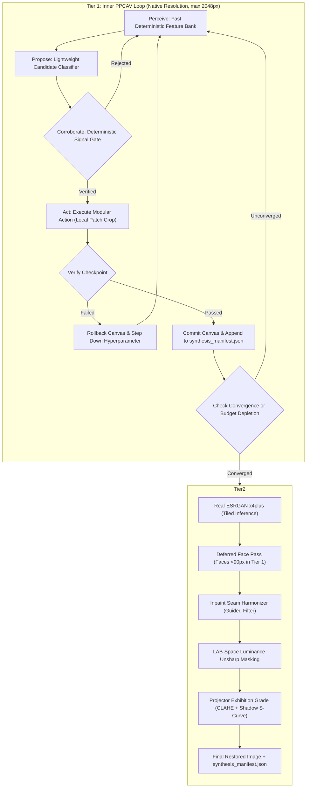

# PixRevive — Production Orchestrator Architecture Plan (v2.0)

**Two-Tier PPCAV Loop: Perceive → Propose → Corroborate → Act → Verify**

Replaces the fragile 14-stage linear feedforward waterfall with a closed-loop control system that evaluates the image dynamically, enforces deterministic mathematical corroboration before firing any generative model, guarantees atomic rollback upon verification failure, and separates native-resolution iterative repair from terminal super-resolution.

---

## 1. Executive Summary & Core Principles

The v1.0 orchestrator plan correctly identified that fixed-sequence pipelines cannot recover from cascade failures (e.g., specular highlights flagged as cracks $\to$ hat brim erased $\to$ jawline smoothed $\to$ waxy skin). However, v1.0 suffered from critical engineering blind spots:
1. **The VLM Dependency Fallacy:** Assumed a heavy multi-billion-parameter VLM in an offline desktop application with no VLM runtime and tight VRAM budgets.
2. **Missing Rollback State Machine:** Failed actions permanently contaminated canvas pixels because no undo mechanism existed.
3. **Scale Inversion Across Super-Resolution:** Interleaving $4\times$ upscaling inside an iterative loop multiplied downstream memory/compute by $16\times$ and broke coordinate geometry.
4. **The "Texture Borrowing" Fantasy:** Proposed borrowing textures across the photo despite the complete absence of semantic material segmentation.
5. **Latency Explosion:** Unbounded iterations of heavy diffusion/GAN models risked spiking runtime from 30s to 5+ minutes.
6. **Frontend Monotonicity Breakage:** Non-deterministic iteration counts broke the UI progress bar and SSE streaming contracts.

This v2.0 specification resolves all six loopholes while preserving the core architectural superiority of closed-loop restoration.

---

## 2. Two-Tier Decoupled Architecture

To eliminate scale drift and prevent memory blowups, processing is partitioned into two distinct physical tiers:



### Rule of Tier Separation
- **Tier 1 (The Loop):** ALL structural repairs, geometric correction, impulse filtering, NLM denoising, inpainting, de-smoothing, DDColor colorization, and primary face restoration run strictly at native input resolution (normalized to max 2048px).
- **Tier 2 (The Terminal Pass):** Real-ESRGAN $4\times$ upscale executes **exactly once** after Tier 1 reaches mathematical convergence. No inpainting, colorization, or iterative de-smoothing ever runs at 4K resolution.

---

## 3. Dual-Engine Perception Stack (No Local VLM Needed)

To eliminate the 4GB–16GB VRAM footprint of a local Vision-Language Model, the perception engine is split into two lightweight, decoupled layers:

```
                      Raw Image
                          │
            ┌─────────────┴─────────────┐
            ▼                           ▼
┌───────────────────────┐   ┌───────────────────────┐
│     Engine A:         │   │       Engine B:       │
│ Fast Feature Bank     │   │ Lightweight Proposer  │
│ (Classical / Numeric) │   │ (Tiny CNN / Rules)    │
│ - Laplacian Variance  │   │ - MobileNetV4 (<20MB) │
│ - Structure Tensor    │   │ - Or Decision Tree    │
│ - Connected Comps     │   │ - Proposes Candidates │
│ - Hough Edge Density  │   │   from Closed Enum    │
└───────────┬───────────┘   └───────────┬───────────┘
            │                           │
            └─────────────┬─────────────┘
                          ▼
            ┌───────────────────────────┐
            │   Deterministic Gate:     │
            │   Signal Corroborator     │
            │   (Confirms or Rejects)   │
            └───────────────────────────┘
```

### 1. Engine A: Fast Deterministic Feature Bank (<15ms per frame)
Computes quantitative image descriptors across a $32 \times 32$ spatial tile grid:
- **High-Frequency Energy ($E_{HF}$):** Tile-level Laplacian variance and high-pass Haar wavelet coefficients.
- **Anisotropic Coherence ($C_{aniso}$):** Eigenvalues of the structure tensor $J = \nabla I \nabla I^T$.
- **Edge Continuity & Density ($D_{edge}$):** Canny edge response vs. Hough line continuity.
- **Color Saturation Variance ($\sigma_{HSV}$):** Chroma distribution and gamut boundaries in LAB space.
- **Connected Component Topology ($CC_{aspect}, CC_{area}$):** Area, aspect ratio, and boundary gradient of luminance extrema.

### 2. Engine B: Closed-Taxonomy Proposer
Proposes candidate defect regions matching the closed 13-item enum:
```python
class DefectCategory(str, Enum):
    OVER_SMOOTHED      = "over_smoothed"       # Detail flattened, plastic appearance
    TEAR_CRACK         = "tear_crack"          # Fracture, crack, hairline scratch
    STAIN_FOXING       = "stain_foxing"        # Chemical spots, water damage, mold
    HOLE_MISSING       = "hole_missing"        # Emulsion loss, paper perforation
    FLAKING_MIRRORING  = "flaking_mirroring"   # Silver mirroring, chipped emulsion
    GLARE_REFLECTION   = "glare_reflection"    # Flash hot-spots, specular sheen
    SKEW_PERSPECTIVE   = "skew_perspective"    # Scanner canvas margin or rotation
    MOIRE_PATTERN      = "moire_pattern"       # Periodic halftone screening
    LOW_RESOLUTION     = "low_resolution"      # Pixelation, undersampled native raster
    UNCOLORED          = "uncolored"           # True monochrome / grayscale
    FADED_COLOR        = "faded_color"         # Color cast, sepia shift, dyes faded
    WAXY_OVERPROCESSED = "waxy_overprocessed"  # Uncanny GFPGAN/beautify mask
    RINGING_HALO       = "ringing_halo"        # Aggressive unsharp mask overshoots
    NONE               = "none"
```
*Optional Cloud VLM Hook:* An opt-in interface (`perception/vlm_cloud_hook.py`) can be enabled via `PIXREVIVE_VLM_API_KEY` for cloud analysis (e.g. Gemini 2.0 Flash / Claude 3.5 Sonnet), but the core local engine remains **100% functional, deterministic, and self-contained**.

---

## 4. The Corroboration Engine: Proposer $\neq$ Verifier

A proposed defect category **never triggers an action directly**. It must be mathematically confirmed by a matching corroborator:

| Proposed Defect | Deterministic Corroboration Check | Acceptance Threshold | Rejection Action |
|---|---|---|---|
| `skew_perspective` | Boundary margin contrast & Hough quad angles | Border width $>4\text{px}$ OR angle $>0.5^\circ$ | Mark clean, no crop |
| `moire_pattern` | 2D FFT power spectrum peak-to-median ratio | Peak ratio $>4.5\times$ outside DC ring | Pass to spatial denoiser |
| `tear_crack` | Canny edge continuity + stroke width profile | Width $\le 4.5\text{px}$, stroke aspect $\ge 2.5$ | Reject (prevent brim erasure) |
| `flaking_mirroring`| Connected component area + boundary Sobel gradient | Mean boundary gradient $\ge 35.0$ | Reject (genuine highlight) |
| `over_smoothed` | Local structure tensor variance vs. resolution floor | $E_{HF} < 0.25 \times \text{Expected}(res)$ | Reject (natural bokeh/soft focus) |
| `uncolored` | Average $A^*, B^*$ standard deviation in LAB space | $\sigma(A^*) < 2.5$ and $\sigma(B^*) < 2.5$ | Skip DDColor, run BW grade |
| `faded_color` | Color cast index: distance of neutral gray from origin | Gray centroid $\Delta E > 6.0$ | Run white-balance balance |
| `waxy_overprocessed` | High-frequency skin energy vs. eye/mouth sharpness ratio | Skin/eye gradient ratio $< 0.12$ | Attenuate GFPGAN blend weight |
| `ringing_halo` | Step-edge gradient overshoot profile | Peak overshoot $> 1.35 \times$ plateau value | Apply bilateral edge-clamp |

---

## 5. Transactional Canvas State Machine (`CanvasTransaction`)

To prevent corrupted model outputs from permanently poisoning the image, all actions execute inside an atomic transaction:

```python
class CanvasTransaction:
    """Guarantees atomic rollback if a restoration action degrades image fidelity."""
    def __init__(self, context: PipelineContext, action_name: str):
        self.context = context
        self.action_name = action_name
        self.backup_image = None
        self.backup_masks = None

    def __enter__(self):
        # Shallow copy of context dicts, deep copy of working image buffer
        self.backup_image = self.context.working_image.copy()
        self.backup_masks = {k: v.copy() for k, v in self.context.damage_masks.items()}
        return self

    def commit(self, action_metadata: dict):
        # Register action into synthesis manifest
        self.context.synthesis_manifest.log_action(
            action=self.action_name,
            status="COMMITTED",
            metadata=action_metadata
        )

    def rollback(self, reason: str, step_down_param: Optional[str] = None):
        # Restore pre-action pixels
        self.context.working_image = self.backup_image
        self.context.damage_masks = self.backup_masks
        self.context.synthesis_manifest.log_action(
            action=self.action_name,
            status="ROLLED_BACK",
            reason=reason
        )
        # Adapt hyperparameters for subsequent attempt
        if step_down_param:
            self.context.step_down_parameter(self.action_name, step_down_param)
```

### Automated Hyperparameter Step-Down Curves
When an action is rolled back:
- **NLM Denoising:** Drops filtering strength $h \leftarrow h \times 0.70$.
- **GFPGAN Face Restoration:** Reduces blend fidelity weight $w_{face} \leftarrow w_{face} \times 0.50$ (biasing toward original face).
- **LaMa Inpainting:** Shrinks mask morphological dilation radius $r \leftarrow \max(1, r - 2)$ to prevent over-expansion.
- **DDColor Colorization:** Reduces chrominance blend opacity $\alpha \leftarrow \alpha \times 0.80$.

---

## 6. Action Library & Budget Weight Matrix

Actions are budgeted in **Cost Points (CP)** to guarantee execution finishes in under 45 seconds total. The loop operates with a **Global Budget of 20 Cost Points**.

| Action | Cost Points | Preconditions | Localized Crop? | Verification Metric | Risk / Provenance |
|---|:---:|---|:---:|---|---|
| `DeskewCrop` | 1 CP | None (always first) | No | Corner angle $= 90^\circ \pm 0.2^\circ$ | Recovered |
| `MoireFilter` | 1 CP | Deskew done | No | FFT peak ratio $< 2.0\times$ | Recovered |
| `ImpulseROAD` | 1 CP | None | No | Outlier pixel count reduction | Recovered |
| `NLMDenoise` | 2 CP | Impulse done | 3-Zone Patch | Edge preservation ratio $> 0.85$ | Recovered |
| `DetailSynth` | 2 CP | Denoise done | Masked Crop | Structure tensor coherence gain | Fabricated (Micro-grain) |
| `LaMaInpaint` | 3 CP | Damage masked | Bounding Box | Boundary gradient smoothness $> 0.80$ | Fabricated |
| `SeamHarmonize`| 1 CP | Immediately post-inpaint | Dilated Seam | Guided filter edge delta $< 12.0$ | Recovered |
| `DDColorize` | 4 CP | Inpaint complete | Downsampled 512 | Chroma bleeding metric $< 0.15$ | Fabricated (Color guess) |
| `GFPGANRestore`| 3 CP | Colorize done | Face Crop Only | Landmark distance $\le 3.5\text{px}$, SSIM $> 0.72$ | Partially Fabricated |

---

## 7. Detail Synthesis (De-Smoothing) Technical Specification

Because PixRevive does not possess a semantic material segmentation model, **inter-region texture borrowing is strictly prohibited** to prevent cross-contamination.

Instead, `DetailSynthesizer` uses an **Anisotropic Structure-Tensor Grain Synthesizer**:

1. **Orientation Mapping:**
   Compute the smoothed Structure Tensor:
   $$J = \begin{bmatrix} K_\rho * I_x^2 & K_\rho * (I_x I_y) \\ K_\rho * (I_x I_y) & K_\rho * I_y^2 \end{bmatrix}$$
   Extract the principal eigenvector angle $\theta(x,y) = \frac{1}{2}\text{atan2}(2 J_{xy}, J_{xx} - J_{yy})$.

2. **Procedural Grain Synthesis:**
   Generate spatial zero-mean Gaussian noise $\eta \sim \mathcal{N}(0, \sigma^2)$.
   Convolve $\eta$ locally with an elliptical directional kernel $G(\theta, \lambda_1/\lambda_2)$ aligned with the natural flow of hair strands or fabric folds.

3. **High-Frequency Residual Re-injection:**
   Capture the noise residual from Stage 5 NLM:
   $$R(x,y) = I_{raw}(x,y) - I_{NLM}(x,y)$$
   Filter $R$ with a bandpass filter $[f_{low}, f_{high}]$ to discard impulse spikes and preserve genuine film grain, then blend into over-smoothed regions:
   $$I_{enhanced} = I + \alpha \cdot \text{Mask}_{oversmoothed} \odot (0.6 \cdot R_{bandpass} + 0.4 \cdot \eta_{aniso})$$

---

## 8. Loop Controller & Convergence Dynamics

```
                  ┌────────────────────────────────────────┐
                  │ Loop Controller Evaluation per Action  │
                  └───────────────────┬────────────────────┘
                                      │
       ┌──────────────────────────────┼──────────────────────────────┐
       ▼                              ▼                              ▼
[Budget Depleted?]          [Oscillation Cycle?]          [Diminishing Returns?]
Cost Points > 20            Action A ↔ Action B           Metric Delta < 0.02
       │                              │                              │
       └──────────────────────────────┼──────────────────────────────┘
                                      │
                                      ▼
                        [Halt Loop & Trigger Tier 2]
```

### Convergence Criteria
The inner loop terminates immediately when **either**:
1. **Zero Unresolved Defects:** The Perceiver detects no defect with confidence $> 0.40$.
2. **Budget Exhaustion:** Total accumulated action cost points reach $\ge 20\text{ CP}$.
3. **Oscillation Detected:** A sequence of $(Action_i, Action_j, Action_i)$ occurs within 4 iterations on overlapping bounding boxes. Both actions are blacklisted.
4. **Diminishing Returns:** Two consecutive actions on the same region yield $< 2\%$ improvement in the verification metric.

---

## 9. Provenance Manifest (`synthesis_manifest.json`)

Delivered alongside the restored image, this manifest details every operation, its spatial coordinates, and whether pixels were authentically preserved or generatively invented:

```json
{
  "version": "2.0",
  "image_hash": "a8f9c4d2e1b7...",
  "overall_authenticity_score": 0.84,
  "actions": [
    {
      "order": 1,
      "action": "DeskewCrop",
      "tier": "Recovered",
      "bbox": [0, 0, 1024, 1024],
      "confidence": 0.99,
      "verification_score": 0.98
    },
    {
      "order": 2,
      "action": "LaMaInpaint",
      "tier": "Fabricated",
      "bbox": [140, 210, 185, 340],
      "damage_type": "tear_crack",
      "surface_area_percent": 1.42,
      "verification_score": 0.89
    },
    {
      "order": 3,
      "action": "GFPGANRestore",
      "tier": "Partially_Fabricated",
      "bbox": [320, 180, 580, 490],
      "face_id": 0,
      "blend_weight": 0.75,
      "landmark_displacement_error_px": 1.82,
      "identity_ssim": 0.81
    }
  ]
}
```

---

## 10. Frontend Progress & SSE Streaming Contract

To prevent breaking [ProgressBar.jsx](file:///d:/Desktop/kapstone/kapstone/PixRevive/frontend/src/components/ProgressBar.jsx) and passing [test_progress_stream.py](file:///d:/Desktop/kapstone/kapstone/PixRevive/tests/test_progress_stream.py), progress percentages are calculated monotonically from **Accumulated Cost Points**:

$$P_{raw} = \begin{cases} 
10 + 75 \times \left(\frac{\text{Accumulated CP}}{20}\right) & \text{during Tier 1} \\
85 + 15 \times \left(\frac{\text{Tier 2 Stage Index}}{4}\right) & \text{during Tier 2}
\end{cases}$$

$$\text{Progress}(t) = \max\left(\text{Progress}(t-1), \; \min(99, \; \lfloor P_{raw} \rfloor)\right)$$

This ensures:
- Progress **never jumps backward** when an action rolls back.
- Tier 1 smoothly advances from $10\% \to 85\%$.
- Tier 2 (Super-Resolution + Exhibition Finish) covers $85\% \to 100\%$.

---

## 11. Refactored File Layout & Architecture Index

```
PixRevive/backend/ai/
├── orchestrator/
│   ├── __init__.py
│   ├── orchestrator.py                 # Master entry point (Tier 1 loop + Tier 2 pass)
│   ├── loop_controller.py              # Budget (20 CP), oscillation, diminishing returns
│   ├── transaction.py                  # CanvasTransaction (checkpoint, rollback, step-down)
│   ├── synthesis_manifest.py           # Provenance tracking & JSON serializer
│   │
│   ├── perception/
│   │   ├── __init__.py
│   │   ├── feature_bank.py             # Engine A: Fast classical numeric metrics (<15ms)
│   │   ├── defect_proposer.py          # Engine B: Lightweight rule/CNN classifier (<20MB)
│   │   ├── corroborator.py             # Deterministic gatekeeper (Proposer ≠ Verifier)
│   │   └── vlm_cloud_hook.py           # Optional opt-in cloud VLM adapter (Gemini/Claude)
│   │
│   ├── actions/
│   │   ├── __init__.py
│   │   ├── action_registry.py          # Action library with preconditions & cost points
│   │   ├── base_action.py              # Abstract Base Action class
│   │   ├── geometry_action.py          # Deskew, crop margins
│   │   ├── denoise_action.py           # Road impulse, 3-zone NLM
│   │   ├── inpaint_action.py           # LaMa bounding box inpaint + seam harmonizer
│   │   ├── detail_action.py            # Anisotropic structure-tensor grain injector
│   │   ├── colorize_action.py          # DDColor + chrominance bleed clamp
│   │   ├── face_action.py              # GFPGAN damage-aware blend + chin fade
│   │   └── superres_action.py          # Real-ESRGAN x4plus (Tier 2 only)
│   │
│   └── checkpoints/
│       ├── __init__.py
│       ├── geometry_checkpoint.py      # Uses ForensicValidator.validate_plane_geometry
│       ├── inpaint_checkpoint.py       # Boundary gradient & frequency consistency
│       ├── identity_checkpoint.py      # Uses IdentityValidator SSIM & landmark shift
│       ├── color_checkpoint.py         # LAB gamut & edge bleed check
│       └── texture_checkpoint.py       # High-frequency overshoot / ringing check
│
├── pipeline/
│   ├── restoration_pipeline.py         # Preserved as a backward-compatible facade
│   └── pipeline_context.py             # Enhanced with transaction stack & manifest
```

---

## 12. Backward Compatibility & Verification Harness

### 1. Zero-Regression Facade
To guarantee all 28 existing tests in `tests/` remain 100% green without modification:
```python
# In backend/ai/pipeline/restoration_pipeline.py:
class RestorationPipeline:
    def __init__(self):
        self.orchestrator = PhotoOrchestrator()
        
    def restore(self, image_input, **kwargs):
        # Delegates directly to the new orchestrator
        return self.orchestrator.run(image_input, options=kwargs)
```

### 2. New Regression Test Suite Additions
Four new permanent automated test fixtures in `tests/test_orchestrator_loop.py`:
1. **`test_transaction_rollback_on_failed_verify`**: Injects an artificial high-contrast corruption; verifies that the transaction reverts `working_image` to the exact byte-level pre-action state.
2. **`test_oscillation_circuit_breaker`**: Constructs a mock scenario where Denoise and DetailSynth repeatedly invert each other; verifies the loop breaks within $\le 4$ iterations.
3. **`test_budget_cap_enforcement`**: Forces continuous unresolved defects; verifies total accumulated Cost Points strictly cap at 20 CP and the pipeline safely exits to Tier 2.
4. **`test_manifest_provenance_integrity`**: Restores a damaged portrait; validates that `synthesis_manifest.json` correctly segregates genuine NLM repairs as `Recovered` and LaMa/GFPGAN modifications as `Fabricated`.
